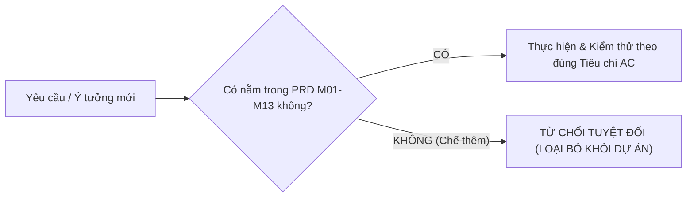
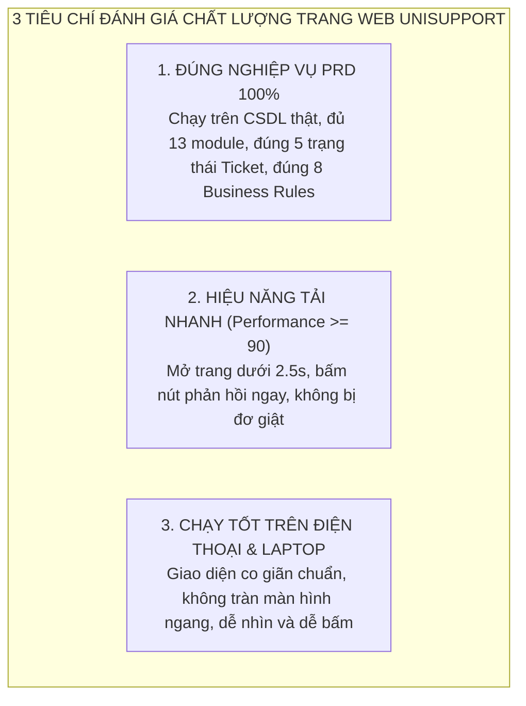

# TÀI LIỆU KIỂM SOÁT CHẤT LƯỢNG (QUALITY CONTROL DOCUMENT)
## HỆ THỐNG TIẾP NHẬN & HỖ TRỢ THỦ TỤC HÀNH CHÍNH SINH VIÊN — UNISUPPORT

> **Dự án:** UniSupport — Nền tảng Tiếp nhận và Hỗ trợ Thủ tục Hành chính Sinh viên (Đại học Aurora)  
> **Đơn vị thực hiện:** Group 4  
> **Phiên bản:** 3.0 — **KHÓA CỨNG PHẠM VI (SCOPE FREEZE): CHỈ LÀM ĐÚNG VÀ ĐỦ 13 PHÂN HỆ PRD (M01–M13), TUYỆT ĐỐI KHÔNG CHẾ THÊM CHỨC NĂNG NGOÀI.**  
> **Tài liệu căn cứ duy nhất:**  
> - [docs/modules/readme.md](file:///c:/VScode/UniSupport/docs/modules/readme.md) (13 Phân hệ PRD)  
> - [docs/domain/quy-tac-nghiep-vu.md](file:///c:/VScode/UniSupport/docs/domain/quy-tac-nghiep-vu.md) (8 Quy tắc nghiệp vụ cốt lõi)  
> - [Team-charter.md](file:///c:/VScode/UniSupport/Team-charter.md) (Quy chế làm việc & Nghiệm thu)

---

## 1. NGUYÊN TẮC CỐT LÕI: KHÔNG CHẾ THÊM CHỨC NĂNG NGOÀI PRD

Nhóm thống nhất nguyên tắc tối cao: **Chỉ làm chính xác những gì đã viết trong PRD, không tự ý sáng tạo hay thêm bất kỳ tính năng nào ngoài phạm vi.**

* **Tuyệt đối không có tính năng tự đăng ký tài khoản** (Tài khoản do trường cấp theo BR-01).
* **Tuyệt đối không có tính năng quên mật khẩu cho SV/NV** (Sinh viên/NV liên hệ IT trường).
* **Tuyệt đối không chế thêm:** Thanh toán, AI Chatbot, Mạng xã hội, quét camera chuyên sâu, hay các luồng phức tạp nằm ngoài 13 module.
* **Mục tiêu duy nhất:** Hoàn thiện đúng 13 Phân hệ chạy trên CSDL thật, giao diện xem tốt trên cả **Điện thoại** và **Laptop**, tốc độ tải nhanh không đơ lag.

---

## 2. TIÊU CHÍ ĐÁNH GIÁ 1 TRANG WEB CHẤT LƯỢNG (THEO PRD & CHUẨN THỰC TẾ)

Một trang web chất lượng trong dự án UniSupport chỉ cần đạt **3 tiêu chí rõ ràng, không vẽ vời**:

### 2.1. Tiêu chí 1: Đúng nghiệp vụ PRD & CSDL thật (100% Functional Pass)
* Mọi dữ liệu tạo ra (Tài khoản, Danh mục, Ticket, Lời nhắn, File, Đánh giá) phải lưu vào CSDL thật (MySQL/PostgreSQL), **không dùng dữ liệu giả/mockup**.
* Luồng Ticket đi đúng 5 trạng thái: `NEW` $\rightarrow$ `IN_PROGRESS` $\rightarrow$ `PENDING` $\rightarrow$ `RESOLVED` $\rightarrow$ `CLOSED`.
* Tuân thủ đúng 8 Quy tắc nghiệp vụ trong [docs/domain/quy-tac-nghiep-vu.md](file:///c:/VScode/UniSupport/docs/domain/quy-tac-nghiep-vu.md).

### 2.2. Tiêu chí 2: Hiệu năng tải trang (Google Lighthouse Performance $\ge 90$)
* **Tốc độ mở trang (LCP):** Bảng danh sách Ticket và Dashboard hiển thị nội dung chính trong vòng **$\le 2.5\text{ giây}$**.
* **Độ nhạy khi bấm nút (INP):** Khi người dùng bấm nút nhận việc, gửi đơn, chuyển trạng thái, giao diện phản hồi ngay trong vòng **$\le 200\text{ms}$**.
* **Ổn định bố cục (CLS $\le 0.1$):** Không bị giật lệch vị trí nút bấm khi đang tải trang.
* **Console sạch sẽ:** Bảng điều khiển Console của trình duyệt không có lỗi đỏ (Zero Red Errors).

### 2.3. Tiêu chí 3: Chạy tốt trên Điện thoại và Laptop (Responsive)
* **Trên Điện thoại di động (Mobile 375px – 430px):**
  * Giao diện vừa khít chiều ngang màn hình, tuyệt đối **không bị thanh cuộn ngang**.
  * Bảng Ticket tự động hiển thị dạng thẻ (Card) dọc để dễ đọc trên màn hình nhỏ.
  * Các nút bấm to rõ, ngón tay chạm dễ dàng không bị bấm nhầm.
* **Trên Laptop / Máy tính để bàn (Desktop 1024px – 1920px):**
  * Hiển thị bảng dữ liệu đầy đủ các cột (Mã đơn, Sinh viên, Trạng thái, Ngày gửi, SLA, Nút thao tác).
  * Dashboard hiển thị biểu đồ trực quan, tận dụng tốt không gian màn hình.

---

## 3. BẢNG KHÓA CỨNG ĐÚNG 13 PHÂN HỆ THEO PRD (KHÔNG THỪA - KHÔNG THIẾU)

Dưới đây là danh mục chính xác 13 Phân hệ, làm đúng các yêu cầu này là **ĐẠT (PASS)**:

| Mã | Tên Phân Hệ | Mô Tả Chức Năng Cốt Lõi Theo PRD | Hiển Thị Mobile / Laptop |
| :---: | :--- | :--- | :--- |
| **M01** | [Đăng nhập & Xác thực](file:///c:/VScode/UniSupport/docs/modules/G%C4%901-NenTang&ChucNangCotLoi/M01-dang-nhap-xac-thuc/prd.md) | - Đăng nhập bằng Mã định danh + Mật khẩu. - Điều hướng đúng 4 Roles (Sinh viên, Nhân viên, Quản lý, Admin). - Đăng xuất. - Nhập sai 5 lần tạm khóa 15 phút (BR-01). Không có nút Đăng ký cho SV/NV. | - **Mobile:** Form vừa màn hình, dễ nhập. - **Laptop:** Form căn giữa trang nhã. |
| **M02** | [Vai trò & Phân quyền](file:///c:/VScode/UniSupport/docs/modules/G%C4%901-NenTang&ChucNangCotLoi/M02-vai-tro-phan-quyen/prd.md) | - Admin cấu hình quyền cho 4 vai trò. | - **Mobile:** Danh sách thẻ. - **Laptop:** Bảng phân quyền. |
| **M03** | [Quản lý tài khoản](file:///c:/VScode/UniSupport/docs/modules/G%C4%901-NenTang&ChucNangCotLoi/M03-quan-ly-tai-khoan/prd.md) | - Admin tạo, xem, tìm kiếm, lọc, khóa/mở khóa tài khoản người dùng trên CSDL thật. | - **Mobile:** Tìm kiếm nhanh, thẻ người dùng. - **Laptop:** Bảng danh sách có lọc theo Role/Phòng ban. |
| **M04** | [Quản lý danh mục](file:///c:/VScode/UniSupport/docs/modules/G%C4%901-NenTang&ChucNangCotLoi/M04-quan-ly-danh-muc/prd.md) | - Admin quản lý danh mục toàn trường. - Quản lý thêm danh mục phòng ban. - Có danh mục "Khác". | - **Mobile:** Danh mục dạng cây thu gọn. - **Laptop:** Bảng/Cây danh mục trực quan. |
| **M05** | [Khởi tạo Ticket (SV)](file:///c:/VScode/UniSupport/docs/modules/G%C4%901-NenTang&ChucNangCotLoi/M05-khoi-tao-ticket/prd.md) | - Chọn Phòng ban $\rightarrow$ Danh mục (hoặc "Khác"). - Nhập Tiêu đề ($\le 150$ ký tự), Nội dung ($\ge 10$ ký tự). - Đính kèm tệp (tối đa 5 file, $\le 5$MB/file: png, jpg, pdf, docx). - Tự sinh mã `[CAT]-[YYYYMMDD]-[SEQ]`. Trạng thái ban đầu: `NEW`. | - **Mobile:** Form nộp đơn cuộn mượt mà. - **Laptop:** Form 2 cột tiện thao tác. |
| **M06** | [Tiếp nhận Ticket (NV)](file:///c:/VScode/UniSupport/docs/modules/G%C4%901-NenTang&ChucNangCotLoi/M06-tiep-nhan-ticket/prd.md) | - Nhân viên xem danh sách đơn `NEW` của phòng mình (BR-02). - Bấm "Tiếp nhận" (Claim) $\rightarrow$ chuyển sang `IN_PROGRESS`. - Kiểm tra không để 2 nhân viên cùng nhận 1 đơn. | - **Mobile:** Thẻ đơn tóm tắt, nút nhận việc to rõ. - **Laptop:** Bảng đơn mới có lọc theo ngày/độ ưu tiên. |
| **M07** | [Xử lý & Trao đổi (NV)](file:///c:/VScode/UniSupport/docs/modules/G%C4%901-NenTang&ChucNangCotLoi/M07-xu-ly-trao-doi/prd.md) | - Cập nhật tiến độ & Ghi chú nội bộ. - Bấm "Yêu cầu bổ sung" $\rightarrow$ chuyển sang `PENDING` (bật đếm ngược 72h). - Bấm chuyển trả đơn sai phòng ban về Admin (`NV-04`). | - **Mobile:** Khung trao đổi dạng chatbox dễ gõ. - **Laptop:** Khung đôi: Chi tiết đơn & Lịch sử trao đổi. |
| **M08** | [Trả kết quả (NV)](file:///c:/VScode/UniSupport/docs/modules/G%C4%901-NenTang&ChucNangCotLoi/M08-tra-ket-qua/prd.md) | - Bắt buộc nhập *Resolution Notes* (kết quả xử lý) mới được lưu (BR-05). - Đính kèm tệp kết quả (nếu có). - Chuyển trạng thái sang `RESOLVED`. | - **Mobile:** Nút hoàn thành cố định cuối màn hình. - **Laptop:** Khung soạn kết quả đầy đủ. |
| **M09** | [Theo dõi & Bổ sung (SV)](file:///c:/VScode/UniSupport/docs/modules/G%C4%902-PhanHeSinhVien/M09-theo-doi-bo-sung/prd.md) | - Sinh viên xem danh sách và chi tiết các đơn của mình. - Bổ sung thông tin khi đơn ở trạng thái `PENDING` $\rightarrow$ về lại `IN_PROGRESS`. - Sinh viên được hủy đơn khi còn ở trạng thái `NEW`. Khi `IN_PROGRESS` thì khóa nút sửa (BR-03). | - **Mobile:** Dòng thời gian trạng thái đổi màu, thông báo đỏ khi cần bổ sung. - **Laptop:** Bảng tra cứu đầy đủ chi tiết lịch sử. |
| **M10** | [Kết quả & Đánh giá (SV)](file:///c:/VScode/UniSupport/docs/modules/G%C4%902-PhanHeSinhVien/M10-ket-qua-danh-gia/prd.md) | - Xem kết quả và tải file giải quyết. - Đánh giá mức độ hài lòng 1–5 sao và nhận xét $\rightarrow$ chuyển sang `CLOSED`. - Nếu không đánh giá, tự động đóng sau 72h. - Đơn `CLOSED` bị khóa vĩnh viễn (BR-06). | - **Mobile:** Modal đánh giá 5 sao dễ bấm. - **Laptop:** Giao diện xem kết quả kèm bảng đánh giá. |
| **M11** | [Quản lý & Điều phối](file:///c:/VScode/UniSupport/docs/modules/G%C4%903-DieuPhoi&GIamSat/M11-quan-ly-dieu-phoi/prd.md) | - Quản lý phân công đơn cho nhân viên trong phòng. - Admin tiếp nhận đơn mục "Khác" và đơn bị trả về sai phòng ban $\rightarrow$ điều chuyển sang đúng phòng ban (`AD-05`). | - **Mobile:** Chọn nhân viên phân công nhanh. - **Laptop:** Bảng điều phối hiển thị tải công việc của cán bộ. |
| **M12** | [Giám sát tiến độ](file:///c:/VScode/UniSupport/docs/modules/G%C4%903-DieuPhoi&GIamSat/M12-giam-sat-tien-do/prd.md) | - Theo dõi đơn tồn đọng, quá hạn SLA tính theo Giờ hành chính (8h00 - 17h00, T2-T6, bỏ T7/CN/Lễ) (BR-08). - Hiển thị cờ cảnh báo vàng/đỏ. | - **Mobile:** Thẻ đơn viền màu cảnh báo SLA. - **Laptop:** Bảng giám sát chuyên sâu kèm bộ lọc. |
| **M13** | [Dashboard & Báo cáo](file:///c:/VScode/UniSupport/docs/modules/G%C4%903-DieuPhoi&GIamSat/M13-dashboard-bao-cao/prd.md) | - Thống kê số lượng theo trạng thái, phòng ban, thời gian xử lý trung bình, điểm CSAT trên CSDL thật. - Biểu đồ trực quan và xuất báo cáo. | - **Mobile:** Biểu đồ hiển thị vừa màn hình, vuốt xem tooltip. - **Laptop:** Dashboard đa widget biểu đồ (Cột, Tròn, Đường). |

---

## 4. BẢO VỆ QUYỀN LỢI CỦA BẠN (KHÔNG BỊ ÉP LÀM THÊM)

Theo đúng [Team-charter.md](file:///c:/VScode/UniSupport/Team-charter.md):
1. **Phạm vi dự án dừng lại ở đúng 13 Phân hệ trên.** Không nhận thêm bất kỳ yêu cầu phát sinh nào từ bất kỳ ai.
2. **Tiêu chuẩn nghiệm thu:** Chỉ cần module của bạn chạy đúng các luồng trên CSDL thật, không lỗi đỏ trên console, mở trên điện thoại không vỡ giao diện $\rightarrow$ **Nghiệm thu Đạt (Done)**.
3. Không đòi hỏi các bài kiểm thử bảo mật cao siêu, không đòi hỏi các công nghệ ngoài lề.
