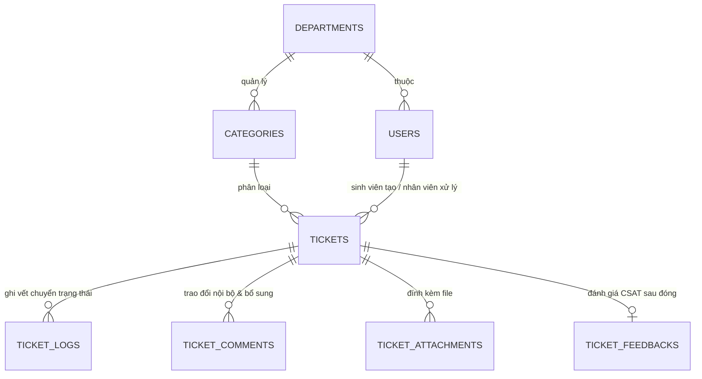

# THIẾT KẾ CƠ SỞ DỮ LIỆU (DATABASE ERD & SCHEMA) — UNISUPPORT

> **Dự án:** UniSupport — Nền tảng Tiếp nhận và Hỗ trợ Thủ tục Hành chính Sinh viên  
> **Phiên bản:** 2.0 (Lead Dev Technical Specification)  
> **Cơ sở dữ liệu khuyến nghị:** PostgreSQL 15+ / MySQL 8.0+

---

## 1. Sơ đồ Quan hệ Thực thể (Mermaid ERD)



---

## 2. Đặc tả Chi tiết các Bảng CSDL (Data Dictionary)

### 2.1. Bảng `departments` (Phòng ban chuyên trách)
| Tên cột | Kiểu dữ liệu | Ràng buộc | Mô tả |
|---|---|---|---|
| `id` | `VARCHAR(36)` / `UUID` | `PRIMARY KEY` | Khóa chính |
| `code` | `VARCHAR(20)` | `NOT NULL, UNIQUE` | Mã phòng ban (VD: `P_CTSV`, `P_DT`, `P_KHTC`) |
| `name` | `VARCHAR(150)` | `NOT NULL` | Tên phòng ban (VD: Phòng Công tác Sinh viên) |
| `description` | `TEXT` | `NULL` | Mô tả chức năng nhiệm vụ |
| `is_active` | `BOOLEAN` | `NOT NULL DEFAULT TRUE` | Trạng thái hoạt động (True = Hoạt động) |
| `created_at` | `TIMESTAMP` | `NOT NULL DEFAULT CURRENT_TIMESTAMP` | Thời điểm tạo |
| `updated_at` | `TIMESTAMP` | `NOT NULL DEFAULT CURRENT_TIMESTAMP` | Thời điểm cập nhật |

---

### 2.2. Bảng `users` (Tài khoản người dùng)
| Tên cột | Kiểu dữ liệu | Ràng buộc | Mô tả |
|---|---|---|---|
| `id` | `VARCHAR(36)` / `UUID` | `PRIMARY KEY` | Khóa chính |
| `user_code` | `VARCHAR(30)` | `NOT NULL, UNIQUE` | MSSV (Sinh viên) hoặc Mã nhân viên (Staff/Admin) |
| `email` | `VARCHAR(100)` | `NOT NULL, UNIQUE` | Email trường (`@fpt.edu.vn`) |
| `password_hash` | `VARCHAR(255)` | `NOT NULL` | Mật khẩu băm (Bcrypt / Argon2) |
| `full_name` | `VARCHAR(100)` | `NOT NULL` | Họ và tên |
| `phone_number` | `VARCHAR(15)` | `NULL` | Số điện thoại liên hệ |
| `role` | `VARCHAR(20)` | `NOT NULL` | Vai trò: `ADMIN`, `MANAGER`, `STAFF`, `STUDENT` |
| `department_id` | `VARCHAR(36)` | `NULL, FK(departments.id)` | Phòng ban (bắt buộc với Manager & Staff) |
| `status` | `VARCHAR(20)` | `NOT NULL DEFAULT 'ACTIVE'` | Trạng thái tài khoản: `ACTIVE`, `INACTIVE` |
| `last_login_at` | `TIMESTAMP` | `NULL` | Lần đăng nhập cuối |
| `created_at` | `TIMESTAMP` | `NOT NULL DEFAULT CURRENT_TIMESTAMP` | Thời điểm tạo |
| `updated_at` | `TIMESTAMP` | `NOT NULL DEFAULT CURRENT_TIMESTAMP` | Thời điểm cập nhật |

---

### 2.3. Bảng `categories` (Danh mục dịch vụ hành chính)
| Tên cột | Kiểu dữ liệu | Ràng buộc | Mô tả |
|---|---|---|---|
| `id` | `VARCHAR(36)` / `UUID` | `PRIMARY KEY` | Khóa chính |
| `department_id` | `VARCHAR(36)` | `NOT NULL, FK(departments.id)` | Phòng ban tiếp nhận xử lý |
| `name` | `VARCHAR(150)` | `NOT NULL` | Tên danh mục (VD: Cấp bảng điểm, Xác nhận SV) |
| `description` | `TEXT` | `NULL` | Mô tả hướng dẫn sinh viên chuẩn bị giấy tờ |
| `sla_business_hours` | `INT` | `NOT NULL DEFAULT 24` | Thời hạn cam kết xử lý (tính theo Giờ hành chính) |
| `is_active` | `BOOLEAN` | `NOT NULL DEFAULT TRUE` | Trạng thái hiển thị (True = Đang mở tiếp nhận) |
| `created_at` | `TIMESTAMP` | `NOT NULL DEFAULT CURRENT_TIMESTAMP` | Thời điểm tạo |
| `updated_at` | `TIMESTAMP` | `NOT NULL DEFAULT CURRENT_TIMESTAMP` | Thời điểm cập nhật |

---

### 2.4. Bảng `tickets` (Đơn yêu cầu hỗ trợ)
| Tên cột | Kiểu dữ liệu | Ràng buộc | Mô tả |
|---|---|---|---|
| `id` | `VARCHAR(36)` / `UUID` | `PRIMARY KEY` | Khóa chính |
| `ticket_code` | `VARCHAR(30)` | `NOT NULL, UNIQUE` | Mã hiển thị duy nhất (VD: `TK-202610-00012`) |
| `title` | `VARCHAR(200)` | `NOT NULL` | Tiêu đề yêu cầu (Min 5 - Max 150 ký tự) |
| `content` | `TEXT` | `NOT NULL` | Nội dung chi tiết yêu cầu (Min 10 ký tự) |
| `category_id` | `VARCHAR(36)` | `NOT NULL, FK(categories.id)` | Danh mục thủ tục |
| `department_id` | `VARCHAR(36)` | `NOT NULL, FK(departments.id)` | Phòng ban phụ trách tiếp nhận |
| `student_id` | `VARCHAR(36)` | `NOT NULL, FK(users.id)` | Sinh viên tạo đơn |
| `assignee_id` | `VARCHAR(36)` | `NULL, FK(users.id)` | Nhân viên đang nhận xử lý đơn |
| `status` | `VARCHAR(30)` | `NOT NULL DEFAULT 'NEW'` | `NEW`, `IN_PROGRESS`, `PENDING`, `RESOLVED`, `CLOSED` |
| `priority` | `VARCHAR(20)` | `NOT NULL DEFAULT 'NORMAL'` | Mức ưu tiên: `LOW`, `NORMAL`, `HIGH`, `URGENT` |
| `supplement_count` | `INT` | `NOT NULL DEFAULT 0` | Số lần yêu cầu bổ sung (Ràng buộc tối đa 1 lần) |
| `pending_deadline` | `TIMESTAMP` | `NULL` | Hạn chót bổ sung (3 ngày làm việc kể từ lúc Pending) |
| `sla_deadline` | `TIMESTAMP` | `NULL` | Hạn chót xử lý theo SLA (Giờ hành chính) |
| `is_overdue` | `BOOLEAN` | `NOT NULL DEFAULT FALSE` | Cờ đánh dấu quá hạn SLA |
| `resolution_notes` | `TEXT` | `NULL` | Nội dung giải trình kết quả (Bắt buộc khi Resolved) |
| `resolved_at` | `TIMESTAMP` | `NULL` | Thời điểm chuyển sang Resolved |
| `auto_close_deadline`| `TIMESTAMP` | `NULL` | Hạn chót tự động đóng sau Resolved (3 ngày làm việc) |
| `closed_at` | `TIMESTAMP` | `NULL` | Thời điểm đóng đơn vĩnh viễn |
| `closed_reason` | `VARCHAR(255)` | `NULL` | Lý do đóng (`RATED`, `TIMEOUT_PENDING`, `TIMEOUT_RESOLVED`) |
| `auto_closed` | `BOOLEAN` | `NOT NULL DEFAULT FALSE` | Cờ xác định hệ thống tự đóng do hết hạn |
| `created_at` | `TIMESTAMP` | `NOT NULL DEFAULT CURRENT_TIMESTAMP` | Thời điểm tạo |
| `updated_at` | `TIMESTAMP` | `NOT NULL DEFAULT CURRENT_TIMESTAMP` | Thời điểm cập nhật |

---

### 2.5. Bảng `ticket_logs` (Nhật ký luân chuyển & Audit Trail)
| Tên cột | Kiểu dữ liệu | Ràng buộc | Mô tả |
|---|---|---|---|
| `id` | `VARCHAR(36)` / `UUID` | `PRIMARY KEY` | Khóa chính |
| `ticket_id` | `VARCHAR(36)` | `NOT NULL, FK(tickets.id)` | Ticket liên quan |
| `actor_id` | `VARCHAR(36)` | `NULL, FK(users.id)` | Người thực hiện (NULL nếu do System Auto) |
| `from_status` | `VARCHAR(30)` | `NULL` | Trạng thái trước khi chuyển |
| `to_status` | `VARCHAR(30)` | `NOT NULL` | Trạng thái sau khi chuyển |
| `action` | `VARCHAR(50)` | `NOT NULL` | Hành động: `CREATE`, `CLAIM`, `REQUEST_SUPPLEMENT`, `SUBMIT_SUPPLEMENT`, `RE_ASSIGN`, `RESOLVE`, `CLOSE`, `AUTO_CLOSE` |
| `note` | `TEXT` | `NULL` | Ghi chú chuyển trạng thái hoặc lý do trả đơn |
| `created_at` | `TIMESTAMP` | `NOT NULL DEFAULT CURRENT_TIMESTAMP` | Thời điểm ghi log |

---

### 2.6. Bảng `ticket_comments` (Trao đổi xử lý & Bổ sung)
| Tên cột | Kiểu dữ liệu | Ràng buộc | Mô tả |
|---|---|---|---|
| `id` | `VARCHAR(36)` / `UUID` | `PRIMARY KEY` | Khóa chính |
| `ticket_id` | `VARCHAR(36)` | `NOT NULL, FK(tickets.id)` | Ticket liên quan |
| `author_id` | `VARCHAR(36)` | `NOT NULL, FK(users.id)` | Người gửi bình luận |
| `type` | `VARCHAR(30)` | `NOT NULL` | `INTERNAL_NOTE` (Nội bộ nhân viên), `SUPPLEMENT_REQUEST` (Yêu cầu bổ sung), `SUPPLEMENT_RESPONSE` (Sinh viên gửi bổ sung) |
| `content` | `TEXT` | `NOT NULL` | Nội dung văn bản trao đổi |
| `created_at` | `TIMESTAMP` | `NOT NULL DEFAULT CURRENT_TIMESTAMP` | Thời điểm gửi |

---

### 2.7. Bảng `ticket_attachments` (Tài liệu & Tệp tin đính kèm)
| Tên cột | Kiểu dữ liệu | Ràng buộc | Mô tả |
|---|---|---|---|
| `id` | `VARCHAR(36)` / `UUID` | `PRIMARY KEY` | Khóa chính |
| `ticket_id` | `VARCHAR(36)` | `NOT NULL, FK(tickets.id)` | Ticket liên quan |
| `uploader_id` | `VARCHAR(36)` | `NOT NULL, FK(users.id)` | Người tải tệp lên |
| `file_name` | `VARCHAR(255)` | `NOT NULL` | Tên gốc của tệp tin |
| `file_url` | `VARCHAR(500)` | `NOT NULL` | Đường dẫn lưu trữ (Cloud/S3/Local storage) |
| `file_size` | `INT` | `NOT NULL` | Dung lượng tính bằng Byte (Tối đa 5MB) |
| `file_extension` | `VARCHAR(10)` | `NOT NULL` | Phần mở rộng (`.png`, `.jpg`, `.pdf`, `.docx`) |
| `attachment_type` | `VARCHAR(30)` | `NOT NULL` | `TICKET_CREATION`, `SUPPLEMENT`, `RESOLUTION` |
| `created_at` | `TIMESTAMP` | `NOT NULL DEFAULT CURRENT_TIMESTAMP` | Thời điểm tải lên |

---

### 2.8. Bảng `ticket_feedbacks` (Đánh giá mức độ hài lòng CSAT)
| Tên cột | Kiểu dữ liệu | Ràng buộc | Mô tả |
|---|---|---|---|
| `id` | `VARCHAR(36)` / `UUID` | `PRIMARY KEY` | Khóa chính |
| `ticket_id` | `VARCHAR(36)` | `NOT NULL, UNIQUE, FK(tickets.id)` | Ticket được đánh giá (1 Ticket có tối đa 1 Feedback) |
| `student_id` | `VARCHAR(36)` | `NOT NULL, FK(users.id)` | Sinh viên thực hiện đánh giá |
| `rating` | `INT` | `NOT NULL` | Điểm đánh giá (1 đến 5 sao) |
| `comment` | `TEXT` | `NULL` | Nhận xét góp ý của sinh viên |
| `created_at` | `TIMESTAMP` | `NOT NULL DEFAULT CURRENT_TIMESTAMP` | Thời điểm đánh giá |

---

### 2.9. Bảng `system_holidays` (Lịch nghỉ lễ & cấu hình ngày làm việc)
*Phục vụ cho Background Worker và hàm tính toán hạn chót 3 ngày làm việc (bỏ qua Thứ 7, Chủ nhật và các ngày được khai báo trong bảng này).*

| Tên cột | Kiểu dữ liệu | Ràng buộc | Mô tả |
|---|---|---|---|
| `id` | `VARCHAR(36)` / `UUID` | `PRIMARY KEY` | Khóa chính |
| `holiday_date` | `DATE` | `NOT NULL, UNIQUE` | Ngày nghỉ lễ theo lịch nhà nước/nhà trường (YYYY-MM-DD) |
| `description` | `VARCHAR(150)` | `NOT NULL` | Tên ngày nghỉ lễ (VD: Tết Dương Lịch, Quốc Khánh 2/9) |
| `is_recurring` | `BOOLEAN` | `NOT NULL DEFAULT FALSE` | Có lặp lại hàng năm không |
| `created_at` | `TIMESTAMP` | `NOT NULL DEFAULT CURRENT_TIMESTAMP` | Thời điểm tạo |

---

## 3. Danh mục Chỉ mục Tối ưu Truy vấn (Database Indexes)

Để đảm bảo hiệu năng hệ thống không bị chậm khi dữ liệu ticket tăng trưởng, bắt buộc đánh chỉ mục:

```sql
-- 1. Tối ưu tìm kiếm và lọc danh sách Ticket theo phòng ban và trạng thái (Staff & Manager)
CREATE INDEX idx_tickets_dept_status ON tickets(department_id, status);

-- 2. Tối ưu màn hình công việc cá nhân của Nhân viên (Assignee Ticket Pool)
CREATE INDEX idx_tickets_assignee_status ON tickets(assignee_id, status);

-- 3. Tối ưu tra cứu danh sách đơn của Sinh viên
CREATE INDEX idx_tickets_student ON tickets(student_id, created_at DESC);

-- 4. Tối ưu Background Worker quét timeout tự động đóng đơn (Pending & Auto-close)
CREATE INDEX idx_tickets_pending_worker ON tickets(status, pending_deadline) WHERE status = 'PENDING';
CREATE INDEX idx_tickets_resolved_worker ON tickets(status, auto_close_deadline) WHERE status = 'RESOLVED';

-- 5. Tối ưu truy vấn Audit Trail và Lịch sử Ticket
CREATE INDEX idx_ticket_logs_ticket_id ON ticket_logs(ticket_id, created_at ASC);
CREATE INDEX idx_attachments_ticket_id ON ticket_attachments(ticket_id);
CREATE INDEX idx_comments_ticket_id ON ticket_comments(ticket_id, created_at ASC);
```
